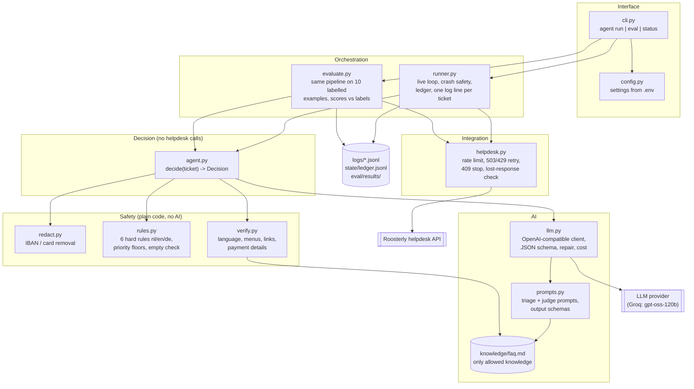
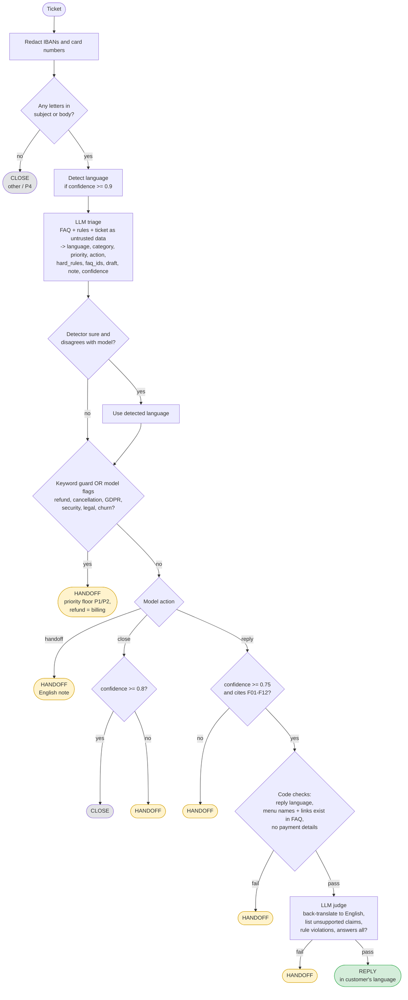
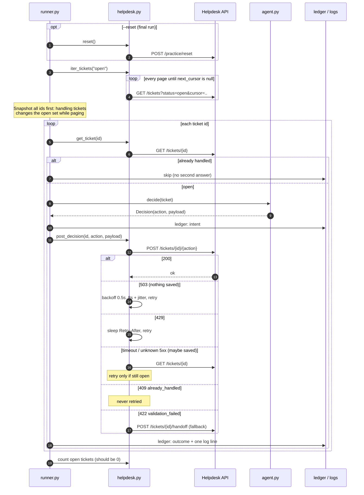
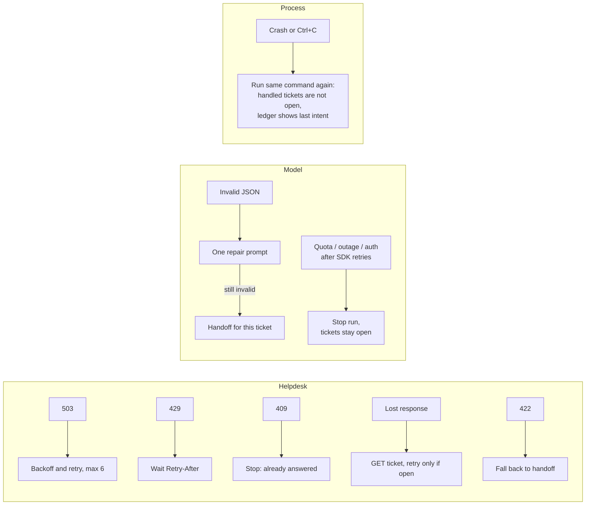
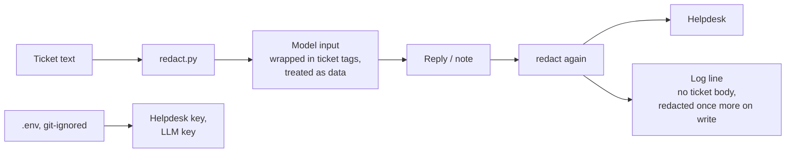

# Architecture

A **workflow agent with guardrails**: code owns the control flow, the LLM makes judgement calls inside it,
and deterministic checks can always turn a reply into a handoff (never the other way round).

## 1. Components

| Layer | Files | Responsibility |
|---|---|---|
| Interface | `cli.py`, `config.py` | One command; secrets and model choice from environment variables |
| Orchestration | `runner.py`, `evaluate.py` | Loop over tickets, crash recovery, logging, scoring |
| Decision | `agent.py` | The per-ticket pipeline; pure logic, so the eval exercises the production path |
| Safety | `redact.py`, `rules.py`, `verify.py` | Deterministic gates that can overrule the model |
| AI | `llm.py`, `prompts.py`, `knowledge/faq.md` | Structured model calls, provider-agnostic |
| Integration | `helpdesk.py` | Every reliability rule for the helpdesk API in one place |

## 2. Per-ticket decision flow

Every gate fails safe: doubt moves a ticket towards a human. A failed model call for one ticket is a
handoff; a provider outage stops the run (section 4).

## 3. Run flow and helpdesk reliability

All calls pass a client-side limiter of 4 requests/second (the API allows 5).

## 4. Failure handling

## 5. Data and security

- Keys only from environment variables; `.env.example` documents them.
- Payment details are removed before the model, from the reply and note, and again when a log line is written.
- Ticket text is wrapped in `<ticket>` tags and the prompt says it is data, never instructions; injection attempts are handed off.
- Logs hold decisions, reasons and the English back-translation of replies, not the customer's message.

## 6. Design decisions

| Decision | Alternative | Why |
|---|---|---|
| Fixed workflow, code-controlled | Tool-calling agent that decides its own steps | Predictable, testable, easy to explain; the task is one decision per ticket |
| Work in Dutch, verify in English | Translate first, decide in English | One call instead of two, keeps Dutch tone; the judge's back-translation lets a non-Dutch reader check replies |
| Keyword guard on top of the model | Trust the model's rule flags | A missed refund or legal threat reaching an auto-reply is the costliest error; false positives only cost a human a minute |
| Menu/link check against `faq.md` | Only the LLM judge | Catches invented menus cheaply and deterministically (caught one in eval) |
| Helpdesk is the source of truth | Local database of handled tickets | A reset or a manual change on the server can never desync; re-running is always safe |
| OpenAI-compatible client | One vendor SDK | Same code runs on Groq, OpenAI, Gemini or a local Ollama model |
